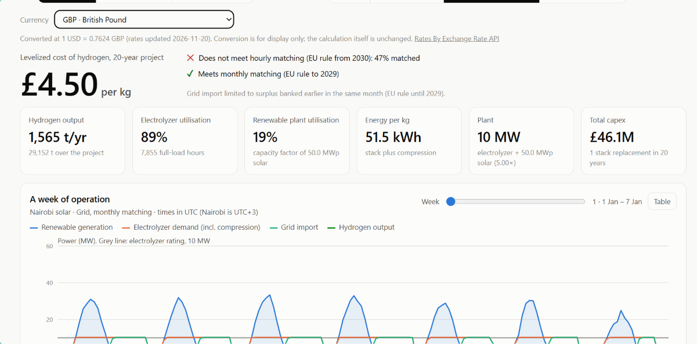
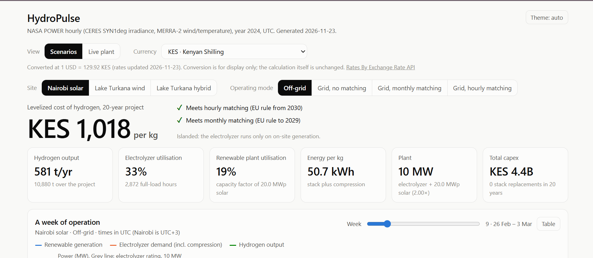
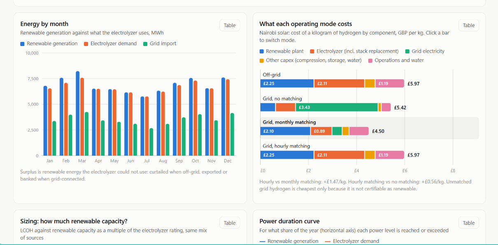
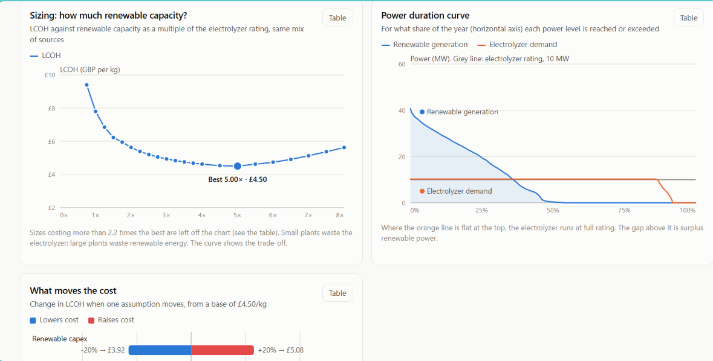
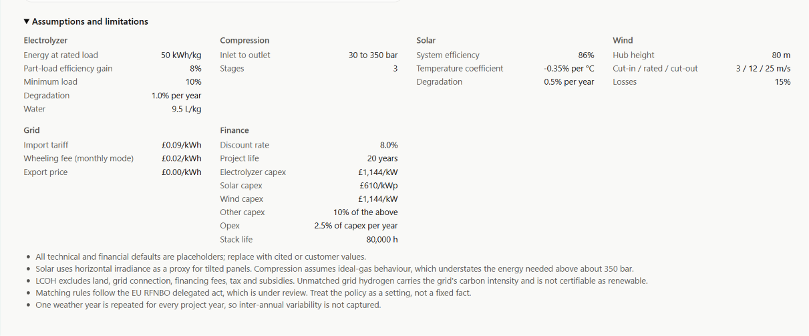
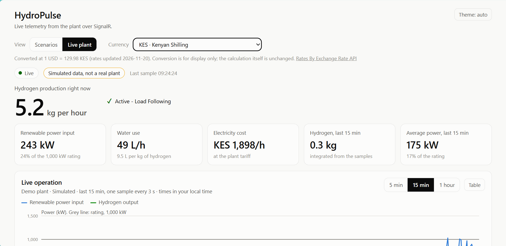
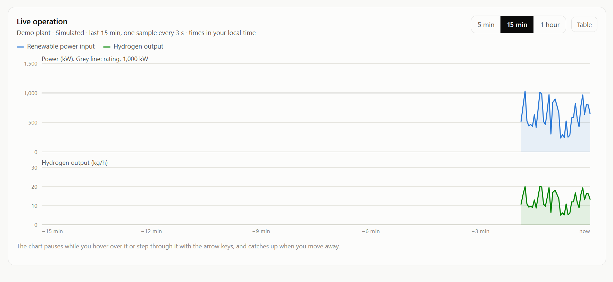
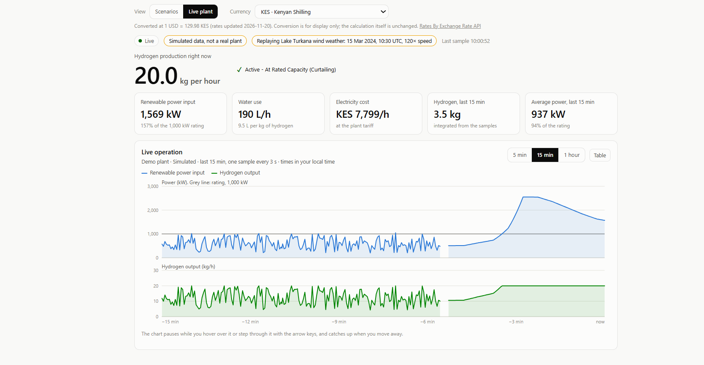
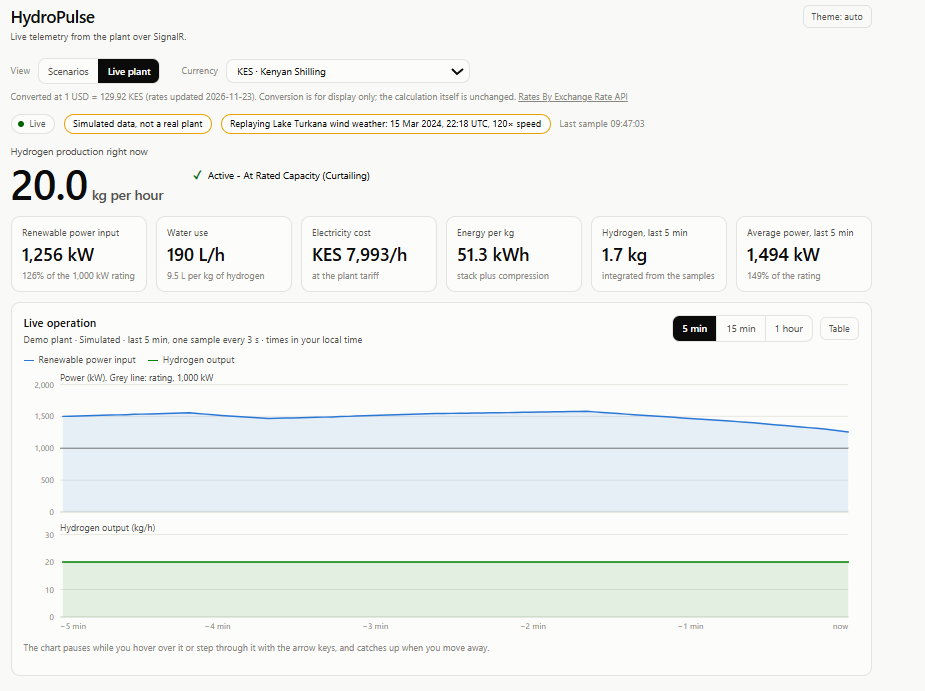

# HydroPulse Enterprise

**Green-hydrogen production orchestration and levelised-cost (LCOH) optimiser.**

HydroPulse answers one question for a power company: *given this site, this renewable mix and this grid arrangement, what does a kilogram of green hydrogen cost, and how should the plant be sized and run to make it cheaper?*

It is built so that **the buyer decides the site and the operating mode**. Off-grid, or grid-connected with no, monthly or hourly renewable matching, are all *configuration*, not code. The same dispatch logic drives both the year-long scenario analysis and the live plant feed, so what you see in the simulation is what the live view produces.

> **Status: development foundation.** All cost and technical inputs are **placeholders** until replaced with cited or customer-supplied values. Weather is real NASA POWER 2024 data, but the "live plant" is a **simulator** that replays that weather. See [Limitations and honesty notes](#limitations-and-honesty-notes).

---

## Contents

1. [What it does](#what-it-does)
2. [Screenshots](#screenshots)
3. [Architecture and repository layout](#architecture-and-repository-layout)
4. [Quick start (Windows PowerShell)](#quick-start-windows-powershell)
5. [Weather data](#weather-data)
6. [Configuration](#configuration)
7. [Dashboard walkthrough](#dashboard-walkthrough)
8. [Live plant view and weather replay](#live-plant-view-and-weather-replay)
9. [Currency](#currency)
10. [Models and equations](#models-and-equations)
11. [Operating modes and EU matching rules](#operating-modes-and-eu-matching-rules)
12. [Current results](#current-results)
13. [API and SignalR reference](#api-and-signalr-reference)
14. [Testing](#testing)
15. [Docker](#docker)
16. [Troubleshooting](#troubleshooting)
17. [Limitations and honesty notes](#limitations-and-honesty-notes)
18. [Security notes](#security-notes)
19. [Roadmap](#roadmap)
20. [References and data sources](#references-and-data-sources)

---

## What it does

- **Scenario engine.** Simulates a full year of hourly operation for a PV, wind or hybrid plant feeding an electrolyzer, then extends to a 20-year cash-flow model with degradation and stack replacement, and reports LCOH with a cost breakdown.
- **Operating modes.** Off-grid; grid-connected with no matching; monthly matching; hourly matching.
- **Optimisation.** Sweeps the renewable-to-electrolyzer ratio to find the cheapest sizing, and runs a one-at-a-time sensitivity (tornado) on the key assumptions.
- **Dashboard.** One standalone page with two views: **Scenarios** (the analysis) and **Live plant** (SignalR telemetry), with light/dark themes, tooltips, keyboard support and a data table behind every chart.
- **Live plant.** An ASP.NET Core worker produces telemetry every 3 seconds, persists it to PostgreSQL and pushes it to the dashboard over SignalR. It can replay real weather (Nairobi or Lake Turkana) at an accelerated clock.
- **Currency.** The model runs in USD; the dashboard converts for display into the buyer's own currency using live rates.

---

## Screenshots

All screenshots are of the dashboard served at `http://localhost:5196/`. Figures shown are **placeholder-input results**, not forecasts.

### Scenarios view

Header with headline LCOH, compliance chips, summary tiles and a representative week of operation (displayed in GBP, Nairobi solar, monthly matching):



The same view in Kenyan shillings (Nairobi solar, off-grid) to show the buyer-currency conversion:



Energy by month and what each operating mode costs:



Sizing curve (cheapest renewable-to-electrolyzer ratio), power duration curve, and the start of the sensitivity tornado:



The assumptions and limitations panel, always visible at the bottom of the Scenarios view:



### Live plant view

First Live tab, with the random demo power source (before weather replay existed), in KES:



The live chart at the 15-minute window with random demo samples:



Turkana wind replay. Older random samples on the left, then the smooth replayed wind profile once replay starts:



Live view with compression energy included (about 51.3 kWh/kg including compression, replay pill showing the simulated site and clock):



---

## Architecture and repository layout

Clean-architecture layering. The **domain engine is pure**: no I/O, no framework dependencies, fully unit-testable.

```
HydroPulse/
├─ src/
│  ├─ HydroPulse.Domain/            Pure engine, no I/O
│  │  ├─ Engineering/
│  │  │  ├─ ElectrolyzerModel       SEC vs load, degradation, min load, water use
│  │  │  ├─ CompressionModel        Ideal-gas multistage compression energy
│  │  │  ├─ PlantDispatch           THE single dispatch function (shared by runner and live worker)
│  │  │  ├─ PvModel / WindModel     Generation from weather
│  │  │  ├─ Weather                 NASA POWER hourly CSV loader
│  │  │  ├─ ScenarioConfig / ScenarioResult / ScenarioRunner
│  │  │  ├─ ScenarioAnalysis        Sizing sweep, sensitivity (tornado)
│  │  │  ├─ LcohCalculator          Discounted cash flows and cost breakdown
│  │  │  └─ RenewableReplay         Hourly weather interpolated to any instant, year wraps
│  │  └─ Entities/TelemetryRecord
│  ├─ HydroPulse.Application/       Interfaces (ITelemetryRepository)
│  ├─ HydroPulse.Infrastructure/    EF Core + Npgsql, migrations, repository
│  └─ HydroPulse.Api/               ASP.NET Core host
│     ├─ Controllers/               TelemetryController, PlantController
│     ├─ Hubs/TelemetryHub          SignalR hub at /hubs/telemetry
│     ├─ Workers/                   H2TelemetrySimulationWorker, ReplaySetup
│     └─ wwwroot/                   Generated dashboard + SignalR client (git-ignored)
├─ tests/HydroPulse.Domain.Tests/   88 xUnit tests
├─ tools/HydroPulse.ScenarioRunner/ Console tool that runs all scenarios and builds the dashboard
│  ├─ Program.cs, FxRates.cs, LiveAssets.cs
│  └─ dashboard.template.html       Vanilla JS + SVG dashboard source
├─ data/weather/                    nairobi-2024.csv, turkana-2024.csv (NASA POWER)
├─ out/                             Generated results.json and dashboard.html (git-ignored)
├─ docker-compose.yml, Dockerfile
└─ generate.ps1
```

**One dispatch function.** `PlantDispatch.Run(model, availableKw, operatingHours, compressionKwhPerKg)` is used by the hourly scenario runner and by the 3-second live worker. This is what guarantees live hydrogen output matches the scenario charts.

**Data flow**

```
NASA POWER CSV ──► Weather ──► PvModel / WindModel ──► available kW
                                                          │
                       ┌──────────────────────────────────┴───────────────┐
                       ▼                                                  ▼
          ScenarioRunner (hourly, 8,784 h)              Live worker (3 s ticks, replay clock)
                       │  PlantDispatch.Run                    │  PlantDispatch.Run
                       ▼                                       ▼
        LcohCalculator, sweep, tornado               PostgreSQL ► SignalR ► Live view
                       ▼
        out/results.json + out/dashboard.html  (same file also served at /)
```

---

## Quick start (Windows PowerShell)

Prerequisites: **.NET 9 SDK**, **PostgreSQL** (via Docker Compose or local), and a modern browser. Internet is only needed once to download weather data and for live FX rates.

```powershell
cd F:\devops\HydroPulse

# 1. Build and test
dotnet build
dotnet test                      # expect 88 passing

# 2. Generate results and the dashboard
dotnet run --project tools\HydroPulse.ScenarioRunner
#   writes out\results.json, out\dashboard.html
#   and src\HydroPulse.Api\wwwroot\index.html (+ lib\signalr.min.js)

# 3. Start the database (host port 5433) and create the tables
docker compose up -d postgres

# 4. Store the connection password in user-secrets (never in git)
dotnet user-secrets set "ConnectionStrings:DefaultConnection" "Host=localhost;Port=5433;Database=hydropulse;Username=postgres;Password=<the POSTGRES_PASSWORD from docker-compose.yml>" --project src\HydroPulse.Api

dotnet ef database update --project src\HydroPulse.Infrastructure --startup-project src\HydroPulse.Api

# 5. Run the API (serves the dashboard and the live feed)
dotnet run --project src\HydroPulse.Api --launch-profile http
```

Then open:

| URL | What |
|---|---|
| `http://localhost:5196/` | Dashboard, Scenarios view |
| `http://localhost:5196/#live` | Dashboard, Live plant view |
| `http://localhost:5196/swagger` | Swagger UI (Development only) |
| `http://localhost:5196/api/plant` | Plant description JSON |

You can also open `out\dashboard.html` directly from disk for the Scenarios view alone; the Live view needs the API.

---

## Weather data

Weather is **NASA POWER hourly, 2024, UTC**, one CSV per site in `data/weather/`:

| File | Site | Latitude | Longitude | Elevation (from file) | Hours |
|---|---|---|---|---|---|
| `nairobi-2024.csv` | Nairobi (solar) | -1.2921 | 36.8219 | 1,642 m | 8,784 |
| `turkana-2024.csv` | Lake Turkana (wind / hybrid) | 2.50 | 36.75 | 873 m | 8,784 |

Parameters: `ALLSKY_SFC_SW_DWN` (irradiance), `WS50M`, `WS10M` (wind speed at 50 m and 10 m), `T2M` (air temperature). Missing values (`-999`) are filled forward.

To download or refresh a site:

```
https://power.larc.nasa.gov/api/temporal/hourly/point?parameters=ALLSKY_SFC_SW_DWN,WS50M,WS10M,T2M&community=RE&longitude=36.8219&latitude=-1.2921&start=20240101&end=20241231&format=CSV&time-standard=UTC
```

Save the result as `data/weather/<site>-2024.csv`. For a new buyer site, change longitude and latitude and add a site entry.

### Adding a buyer site or measured weather

Create `data/sites.json` (start from `data/sites.example.json`) and re-run the scenario runner. Each entry adds a site to every operating mode, with its own sizing sweep and tornado. The built-in NASA sites stay unless `"includeBuiltIn": false`.

```json
{
  "includeBuiltIn": true,
  "sites": [
    { "label": "Turkana measured wind", "weatherFile": "turkana-measured-2024.csv", "format": "measured",
      "elevationM": 873, "measuredHeightM": 80, "shearExponent": 0.14,
      "pvKwp": 0, "windKw": 10000, "dataNote": "met mast, 80 m" }
  ]
}
```

`format` is `nasa` (a NASA POWER CSV) or `measured`. A measured CSV needs these columns (names are case-insensitive, `#` lines are skipped):

| Column | Required | Meaning |
|---|---|---|
| `timestamp_utc` | yes | ISO 8601, e.g. `2024-01-01T00:00:00Z`. Strictly hourly, ascending, no gaps. |
| `wind_speed_ms` | yes | Hourly mean wind speed at `measuredHeightM`. |
| `ghi_w_m2` | no | Global horizontal irradiance, hourly mean. |
| `temp_c` | no | Air temperature. |

Blank, `NaN` or `-999` cells are carried forward from the previous hour and reported as "missing values filled". Measured speeds are converted to 50 m and 10 m with a power-law shear exponent so the existing wind model gives the same hub-height speed as your measurement. A site with an incomplete year (gaps or fewer than 8,760 hours) is rejected or should be gap-filled first, because the 20-year model repeats one year. The dashboard's data-source note lists which sites use customer data.

---

## Configuration

Everything the buyer varies is configuration.

### Scenario inputs (`ScenarioConfig`)

All values below are **placeholders** and must be replaced with cited or customer data.

| Group | Setting | Default |
|---|---|---|
| Finance | Discount rate | 9% (sourced, see `docs/SOURCES.md`) |
| | Project life | 20 years |
| | Electrolyzer capex | $1,800 / kW (sourced range) |
| | PV capex | $800 / kWp |
| | Wind capex | $1,500 / kW |
| | Other capex (BOP, install) | 10% of equipment |
| | Opex | 2.5% of capex / year |
| | Stack life / replacement | 80,000 h / 30% of electrolyzer capex |
| | Water price | $2 / m³ |
| Grid | Tariff | $0.12 / kWh |
| | Maximum import price | $0.12 / kWh |
| | Export price | $0 / kWh |
| | Wheeling charge (monthly matching) | $0.02 / kWh |
| | Max import power | unlimited |
| | Off-peak tariff (optional) | none (flat tariff); off-peak hours 22:00-06:00 local, UTC+3 |
| | Demand charge (optional) | $0 per kVA per month, power factor 0.95 |
| Compression | Pressure | 30 to 350 bar, 3 stages |
| Electrolyzer | Rated specific energy | 50 kWh/kg |
| | Minimum load | 10% |
| | Water | 9.5 L/kg |

### Live plant (`appsettings.json`)

```json
{
  "Telemetry": {
    "Source": "Simulated",
    "Replay": {
      "Enabled": true,
      "Site": "Turkana",
      "Source": "Wind",
      "RenewableToElectrolyzerRatio": 3.0,
      "SpeedUp": 120,
      "StartDate": "2024-03-15",
      "WeatherFile": ""
    }
  }
}
```

| Key | Values | Meaning |
|---|---|---|
| `Telemetry:Source` | `Simulated` | Label shown in the UI. A real plant adapter replaces the simulator later. |
| `Replay:Enabled` | `true` / `false` | If false, or if setup fails, the worker falls back to random 200-1050 kW demo power. |
| `Replay:Site` | `Nairobi` / `Turkana` | Which weather file to replay. |
| `Replay:Source` | `Solar` / `Wind` / `Hybrid` | Generation type. |
| `Replay:RenewableToElectrolyzerRatio` | number, default 2.0 | Renewable capacity as a multiple of the 1,000 kW electrolyzer. |
| `Replay:SpeedUp` | 1-3600, default 60 | Simulated seconds per real second. |
| `Replay:StartDate` | date | Only month, day and hour are used (the year is always 2024 weather). |
| `Replay:WeatherFile` | path | Optional override of the CSV. |

Override any key on the command line without editing the file:

```powershell
dotnet run --project src\HydroPulse.Api --launch-profile http -- --Telemetry:Replay:Site=Turkana --Telemetry:Replay:Source=Wind
```

> `appsettings.json` is JSON, not a shell command. Edit the file; do not paste it into PowerShell.

### Fixed live-plant identifiers

| Item | Value |
|---|---|
| Plant ID | `7c1d3a52-5f0e-4d5b-9a0e-1b6e4f2a8c01` |
| Stack ID | `a3f4e0b8-2d61-4c7a-8e35-9d1f0c6b7a02` |
| Rated power | 1,000 kW |
| Tick interval | 3 s |
| Live tariff | $0.06 / kWh |

### Reducing log noise

EF Core logs every INSERT at Information level. To silence it, add to `Logging:LogLevel` in `appsettings.json`:

```json
"Microsoft.EntityFrameworkCore.Database.Command": "Warning"
```

---

## Dashboard walkthrough

The dashboard is a single self-contained page (vanilla JavaScript and SVG, no chart library). Every chart has a tooltip, keyboard support and an accessible data table twin; colours come from a validated palette with separate light and dark steps.

### Scenarios view

Filters at the top select **site** and **operating mode**. Everything below recomputes from the precomputed results.

- **Hero LCOH.** Levelised cost per kg for the selected scenario, with compliance chips (for example whether the mode meets monthly or hourly matching).
- **Six tiles.** Annual hydrogen, electrolyzer capacity factor, renewable generation and related headline numbers, plus the best sizing ratio.
- **A week of operation.** Hourly renewable supply against electrolyzer draw, so the effect of dispatch, curtailment and grid import is visible.
- **Energy by month.** Where energy goes each month: to the electrolyzer, curtailed, exported, imported.
- **What each operating mode costs.** LCOH for all four modes at the same site, with the cost breakdown, which makes the price of compliance obvious.
- **Sizing curve.** LCOH against renewable-to-electrolyzer ratio, with the optimum marked.
- **Power duration curve.** Hours per year at or above each power level.
- **Tornado.** One-at-a-time sensitivity of LCOH to the main assumptions.
- **Assumptions and limitations.** Everything the numbers rest on, kept on the page so a screenshot is never misleading.

### Live plant view

See below.

---

## Live plant view and weather replay

The Live tab connects to the SignalR hub and shows what the plant is doing now:

- Connection pill, a permanent **"Simulated data, not a real plant"** tag, and a replay pill showing the replayed site, source and simulated date and time.
- Hero **hydrogen production (kg/h)**.
- Six tiles, including **Energy per kg** (stack plus compression), renewable input, water use and electricity cost per hour.
- A live chart with **5 min / 15 min / 1 hour** windows and a table twin. While replaying, a **Simulated time / Real time** switch chooses the x-axis: simulated shows the weather clock (UTC) the plant is replaying, real shows minutes before now. The table gains a simulated-time column.

On load it fetches history from `GET /api/telemetry?limit=N`, then appends `ReceiveTelemetry` events.

### Replay

`RenewableReplay` interpolates the hourly NASA series linearly to any instant and wraps at the end of the year. The worker advances simulated time by `IntervalSeconds x SpeedUp` each tick, so at `SpeedUp=120` a 3-second tick is 6 simulated minutes and a day passes in 12 real minutes.

Power then passes through `PlantDispatch.Run`, which includes compression as a parasitic load, so **live kg/h and kWh/kg are computed exactly as in the scenario charts**.

When replay starts after random samples were already stored, the chart shows the transition (see the Turkana screenshot above). Clear old rows or start a fresh database for a clean curve.

---

## Currency

The model always computes in USD. Conversion is **display-only**: a currency picker in the header applies `money()` with an `{code, rate}` object to every monetary value, axis and tooltip. Nothing in the engine changes.

- Rates come from the ExchangeRate-API open endpoint `https://open.er-api.com/v6/latest/USD` (attribution required; see references).
- The scenario runner caches the latest fetch in `data/fx-cache.json` and embeds rates in the dashboard, so it works offline with the last known rates.
- The buyer can pick any supported currency (the screenshots show GBP and KES).

---

## Models and equations

### Electrolyzer

Specific energy consumption at load fraction *l* (0 to 1) after *h* operating hours:

```
SEC(l) = SEC_rated x (1 - 0.08 x (1 - l)) x (1 + 0.01 x h / 8760)
```

- Part-load is more efficient per kg (up to 8% lower SEC at very low load).
- Stack degradation adds 1% SEC per year of operation.
- Minimum load 10% of rated; below it the stack is in **standby**.
- Water: 9.5 L/kg.

### Compression

Ideal-gas, multistage, equal pressure ratio per stage, intercooled to the inlet temperature:

```
w = n x (g/(g-1)) x (R/M) x T1 x ((p2/p1)^((g-1)/(g n)) - 1) / eta
```

with g = 1.41, T1 = 300 K, eta = 0.75. Default 30 to 350 bar in 3 stages gives about **1.27 kWh/kg**; 30 to 700 bar in 4 stages gives about 1.62 kWh/kg. Real hydrogen is non-ideal at high pressure, so treat values above about 350 bar as lower bounds.

### Compression as a parasitic load

Compression power depends on hydrogen produced, which depends on stack power, which depends on what is left after compression. `PlantDispatch` solves this by fixed-point iteration (5 iterations):

```
stack_kW = min(rated, available_kW / (1 + e_c / SEC))
```

where *e_c* is compression energy per kg. At saturation the stack runs at rated power and hydrogen output is the rated figure; what rises is total energy per kg and cost.

The dispatch mode is **Saturated** when the target stack power exceeds rating, **PartLoad** when between minimum and rated, and **Standby** below minimum load.

### Photovoltaic

```
P = kWp x (G/1000) x 0.86 x (1 + gamma x (Tcell - 25)),   Tcell = Tair + (NOCT - 20)/800 x G
```

gamma = -0.35 %/C, NOCT = 45 C, degradation 0.5 %/year, output clamped to rated capacity. Uses **global horizontal irradiance** as a proxy for plane-of-array (no tilt or tracking model), so tilted or tracked arrays are slightly underestimated.

### Wind

- Hub height 80 m. Speed extrapolated from the 50 m value with a power law whose exponent is derived each hour from the 10 m and 50 m speeds, `alpha = ln(v50/v10) / ln(5)`, clamped to 0.05-0.40.
- Air density from site elevation (barometric formula) and temperature (ideal gas); speed density-normalised as `v_eff = v x (rho/1.225)^(1/3)`.
- Cubic ramp between cut-in 3 m/s and rated 12 m/s, cut-out 25 m/s, 15% combined losses.

### LCOH

`LcohCalculator` discounts the capex, opex, stack replacements (at 80,000 operating hours, costing 30% of electrolyzer capex), water and electricity over the project life and divides by discounted hydrogen output. It reports a cost breakdown (electrolyzer, renewables, other capex, opex, replacement, water, grid energy).

### 20-year simulation

Year 1 is simulated hourly from weather. Later years apply PV degradation and stack degradation (SEC increases with operating hours), and stack replacement resets the stack age when the life limit is reached.

### Sizing sweep and sensitivity

- **Solar/wind split.** For sites with both sources, `OptimizeMix` tries solar shares from 0% to 100% in 10% steps, finds the cheapest capacity ratio for each (0.5x to 8x), and keeps the cheapest split. The scenario then sizes around that split. The dashboard shows the whole curve in the *Solar and wind split* card.
- **Sweep.** `ScaleRenewables` scales PV and wind together, keeping their mix, so that renewable capacity = ratio x electrolyzer rating. Ratios 0.5 to 4.0 in steps of 0.25, then 4.5 to 8.0 in steps of 0.5.
- **Tornado.** Each key assumption is moved low and high, one at a time, and the LCOH change is recorded.

---

## Operating modes and EU matching rules

| Mode | Behaviour |
|---|---|
| **Off-grid** | Only on-site renewables. Surplus is curtailed. |
| **Grid, no matching** | The plant may import whenever the tariff is at or below the maximum import price. Cheapest, but the hydrogen is not renewable-certified. |
| **Grid, monthly matching** | Import in a month is limited to surplus renewable energy banked earlier in the same month, and a wheeling charge applies ($0.02/kWh default). |
| **Grid, hourly matching** | Imports are not allowed to count, so the plant behaves as off-grid. |

The EU RFNBO rules (Delegated Regulation (EU) 2023/1184 on additionality and temporal correlation) require **monthly** matching until **31 December 2029** and **hourly** matching from **1 January 2030**, and the hourly requirement is under review. The matching policy is therefore a **setting**, not hard-coded, so the buyer can follow whichever rule applies in their market.

---

## Current results

Nairobi at 10,000 kWp base capacity, 2024 weather, defaults of 9% discount rate and $1,800/kW electrolyzer. Several inputs are still placeholders (see [`docs/SOURCES.md`](docs/SOURCES.md)), so these are for comparing modes and checking the pipeline, not for a bid.

| Site | Mode | Best ratio | LCOH (USD/kg) | Electrolyzer CF |
|---|---|---|---|---|
| Nairobi solar | Off-grid | 2.00 | 9.10 | 33% |
| | Grid, no matching | 1.75 | 7.54 | 100% |
| | Grid, monthly | 5.00 | 6.53 | 89% |
| | Grid, hourly | 2.00 | 9.10 | 33% |
| Turkana wind | Off-grid | 3.25 | 11.27 | 52% |
| | Grid, no matching | 0.50 | 8.30 | 100% |
| | Grid, monthly | 3.75 | 10.15 | 66% |
| | Grid, hourly | 3.25 | 11.27 | 52% |
| Turkana hybrid (best split: 100% solar) | Off-grid | 2.00 | 8.81 | 34% |
| | Grid, no matching | 1.75 | 7.41 | 100% |
| | Grid, monthly | 4.50 | 6.26 | 88% |
| | Grid, hourly | 2.00 | 8.81 | 34% |

> **Do not quote the Turkana wind or hybrid rows.** The solar/wind optimiser chooses 100% solar at Turkana in every mode, which says the wind input is too weak to earn any share. NASA POWER gives a mean 50 m wind speed of only 6.59 m/s for the file used here and an 18% wind capacity factor, while the 310 MW Lake Turkana Wind Power plant expects about 1,250 GWh a year, roughly a 46% capacity factor (our arithmetic from that figure). The dashboard shows a data-caution note on every wind or hybrid scenario. Replace the input with measured data via `data/sites.json`.

Earlier placeholders (8% and $1,500/kW) gave, for example, Nairobi off-grid $7.84/kg and Nairobi monthly $5.90/kg, so the sourced defaults raise cost by roughly $0.60-1.30/kg.

Renewable capacity factors are about 18-19%. Hourly matching equals off-grid by construction, which is the point of the comparison: the dashboard shows what the compliance rule costs.

---

## API and SignalR reference

### REST

| Method and path | Returns |
|---|---|
| `GET /api/plant` | `plantId`, `stackId`, `name`, `ratedPowerKw`, `intervalSeconds`, `tariffUsdPerKwh`, `compressionKwhPerKg`, `source`, `hub`, `replay` |
| `GET /api/telemetry?limit=N` | Latest telemetry, newest first. `limit` is capped at 2000. |

Telemetry record:

```json
{
  "id": "guid",
  "stackId": "guid",
  "timestamp": "UTC",
  "renewablePowerInputKw": 0.0,
  "hydrogenProducedKgPerHour": 0.0,
  "waterConsumedLitersPerHour": 0.0,
  "electricityCostPerHour": 0.0,
  "operationalStatus": "PartLoad"
}
```

### SignalR

- Hub URL: `/hubs/telemetry`
- Client to server: `JoinPlantGroup(plantId)`
- Server to client: `ReceiveTelemetry` (one record per tick) and `ReplayClock` (simulated time while replaying)

The dashboard is served by the API from `wwwroot/index.html`, so it shares an origin with the hub and needs no CORS. CORS origins `http://localhost:3000` and `http://localhost:5173` are allowed for external front-ends.

The SignalR browser client is saved locally at `wwwroot/lib/signalr.min.js` (Microsoft SignalR 8.0.7) with a CDN fallback, so the Live view works offline.

---

## Testing

```powershell
dotnet test
```

88 xUnit tests in `tests/HydroPulse.Domain.Tests`:

| Suite | Covers |
|---|---|
| `ElectrolyzerTests` | SEC, part-load, degradation, minimum load, water |
| `GenerationModelTests` | PV and wind output, temperature and density effects, cut-in/out |
| `ScenarioRunnerTests` | Modes, matching rules, cash flows, reproducibility |
| `RenewableReplayTests` | Interpolation, year wrap, start time |
| `PlantDispatchTests` | Saturation, part-load, standby, compression parasitic load |
| `GridTariffTests` | Off-peak window, hour-by-hour import gating, demand charge |
| `MixOptimizerTests` | Solar/wind split search: end points, best share, validation |
| `MeasuredWeatherTests` | Measured CSV import, height conversion, gap and column validation |

The scenario runner's printed table is also a regression check: refactors should leave it unchanged.

---

## Docker

`docker-compose.yml` defines:

| Service | Container | Port |
|---|---|---|
| `postgres` | `hydropulse_db` | 5433 to 5432 (host port 5433, so it cannot clash with a local PostgreSQL on 5432) |
| `api` | `hydropulse_api` | 5196 to 8080 |

Notes:

- The API image is built from the `Dockerfile`; an **old image does not contain the newest code, the generated `wwwroot` or the weather files**. For development, run the API with `dotnet run` and use Docker only for Postgres.
- If the API container is set to `restart: always` it will reclaim port 5196 after a reboot. Stop it with `docker stop hydropulse_api` and `docker update --restart=no hydropulse_api`.

---

## Troubleshooting

| Symptom | Cause and fix |
|---|---|
| `password authentication failed` (28P01) | The password in user-secrets does not match `POSTGRES_PASSWORD` in `docker-compose.yml`, or you saved a placeholder. Re-run `dotnet user-secrets set` with the real value. |
| EF says "database is already up to date" but the container is empty | You are connected to a different PostgreSQL. A native Windows PostgreSQL service on port 5432 takes `localhost` connections ahead of Docker. Check with `Get-NetTCPConnection -LocalPort 5432 -State Listen`. This project uses host port **5433** for the container for that reason. |
| `address already in use` on 5196 | The `hydropulse_api` container or an old API process holds the port. `docker stop hydropulse_api`, or `Get-NetTCPConnection -LocalPort 5196` then `Stop-Process -Id <pid>`. |
| Build fails: DLL locked | An old API process is still running. Stop it, then rebuild. |
| `Expand-Archive` cannot find the zip | The browser saved it under a different name or folder. Use `Get-ChildItem $HOME\Downloads -Filter *.zip` to locate it. |
| Live tab shows "disconnected" | The API is not running, or you opened `out\dashboard.html` from disk instead of `http://localhost:5196/`. |
| Live chart shows jagged then smooth data | Old random rows are still in the table. Clear them for a clean replay. |
| Weather file not found | Place `nairobi-2024.csv` and `turkana-2024.csv` in `data\weather\`. |
| Replay does nothing | Check `Telemetry:Replay:Enabled`; setup failures fall back to random power and are logged. |
| Pasting JSON into PowerShell errors | The `appsettings` snippet is a file edit, not a command. |
| Exchange rates stale | Offline runs use `data/fx-cache.json`; re-run the scenario runner online to refresh. |

---

## Limitations and honesty notes

1. **The live plant is simulated.** Telemetry is produced by a worker that replays weather through the same dispatch logic. It is clearly tagged in the UI and in `GET /api/plant` (`source`).
2. **Placeholder inputs.** Some inputs now have a cited reference range, the rest are still placeholders. See [`docs/SOURCES.md`](docs/SOURCES.md) for exactly which. Do not quote any LCOH figure externally until the inputs are replaced with cited or customer values.
3. **Weather is reanalysis, not measurements.** NASA POWER is gridded reanalysis and satellite data. Lake Turkana wind is **understated**: the file's mean 50 m wind speed is 6.59 m/s and the modelled wind capacity factor is 18%, against about 46% expected by the operating Lake Turkana Wind Power plant (derived from its published 310 MW and 1,250 GWh a year). On-site measurement or a resource assessment is required for a real project.
4. **Single-year weather.** 2024 is repeated for the whole project life. No inter-annual variability.
5. **PV uses horizontal irradiance** with no tilt, tracking, shading or inverter clipping model.
6. **Wind** uses a generic power curve, not a turbine-specific one.
7. **Hybrid mix** is optimised in 10% steps of solar share (0-100%) with the capacity ratio searched at each step. The search is coarse, assumes both sources share one site's weather, and ignores land, grid-connection and per-source cost differences beyond the capex inputs.
8. **Compression** uses an ideal-gas model; real-gas effects above ~350 bar are ignored. Storage and dispensing are not modelled.
9. **Grid carbon intensity is not modelled.** "No matching" hydrogen is cheaper but not certified green.
10. **Hourly dispatch** in scenarios. Sub-hourly ramping, start-up times and transient effects are not modelled.
11. **Simulated-time axis is estimated** from the replay speed and the newest clock message. If the API restarts inside the visible window, older points can be mislabelled until they scroll out.
12. **Currency** conversion is display-only and uses a single spot rate, with no inflation or forward FX.

---

## Security notes

- **Never commit secrets.** The database password lives in .NET **user-secrets** (`dotnet user-secrets`), not in `appsettings.json`.
- A password was previously exposed during development. **Rotate it**, and clean git history if it was ever committed (for example with `git filter-repo`), then force-push only after coordinating with collaborators.
- `bin/`, `obj/`, `out/` and the generated `wwwroot/` are git-ignored.
- The dashboard calls one external API (exchange rates) from the scenario runner at build time, not from the browser.
- Swagger is enabled only in Development.
- There is **no authentication yet**. Add it before any deployment beyond localhost.

---

## Roadmap

- Buyer weather import via a browser upload (the file-based `data/sites.json` import exists).
- Grid carbon-intensity model and certificate-aware modes.
- Finish the cited input table ([`docs/SOURCES.md`](docs/SOURCES.md)): stack life, replacement cost, opex and the other placeholders still need sources.
- Tariff structure with demand charge and time-of-use price.
- Real plant adapter (OPC UA or MQTT) replacing the simulator behind `Telemetry:Source`.
- Docker image with `wwwroot` and weather data baked in.
- Authentication and multi-plant support.
- Remove leftover scaffolding (`Class1.cs`, `UnitTest1.cs`, old `ElectrolyzerStack` and `LcohOptimizationService`).

---

## References and data sources

- NASA POWER, Prediction Of Worldwide Energy Resources, hourly API: https://power.larc.nasa.gov/docs/services/api/temporal/hourly/
- Commission Delegated Regulation (EU) 2023/1184 on renewable fuels of non-biological origin (RFNBO), additionality and temporal correlation rules: https://eur-lex.europa.eu/eli/reg_del/2023/1184/oj
- ExchangeRate-API open access endpoint, rates by [ExchangeRate-API](https://www.exchangerate-api.com): https://open.er-api.com/v6/latest/USD
- Microsoft ASP.NET Core SignalR JavaScript client 8.0.7 (cdnjs `microsoft-signalr`).
- IEC 61400-12 (power performance measurement; air-density normalisation of wind speed).
- Standard thermodynamic relations for multistage intercooled gas compression.

---

*Prepared as the foundation of a thesis project. Every number in this repository that is not read from NASA POWER is an assumption until cited.*
